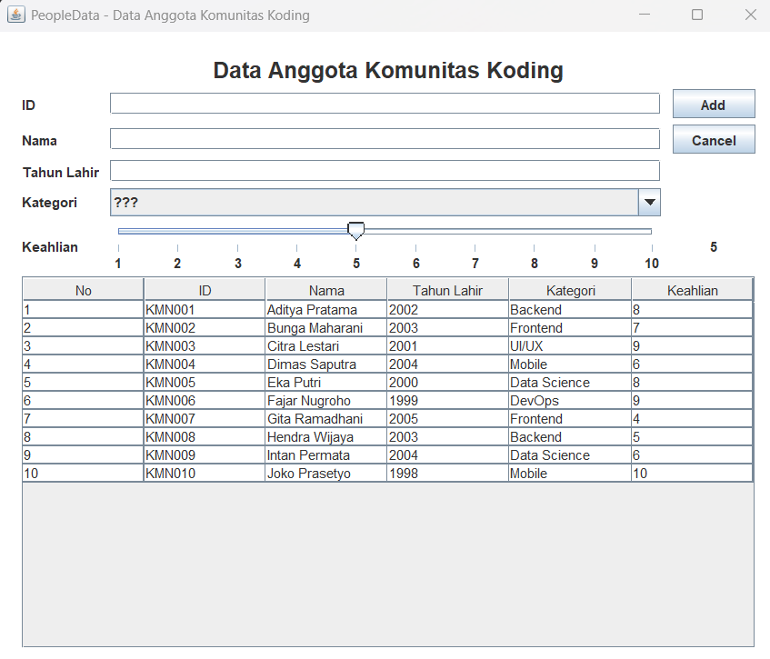
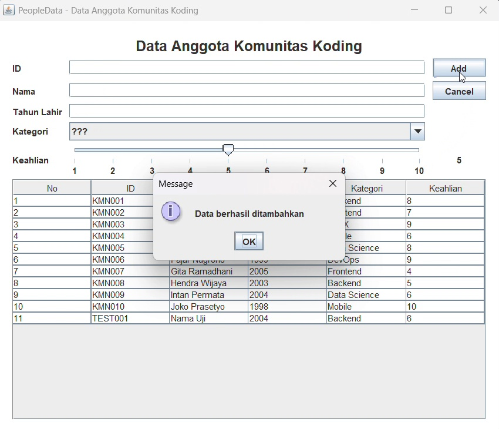
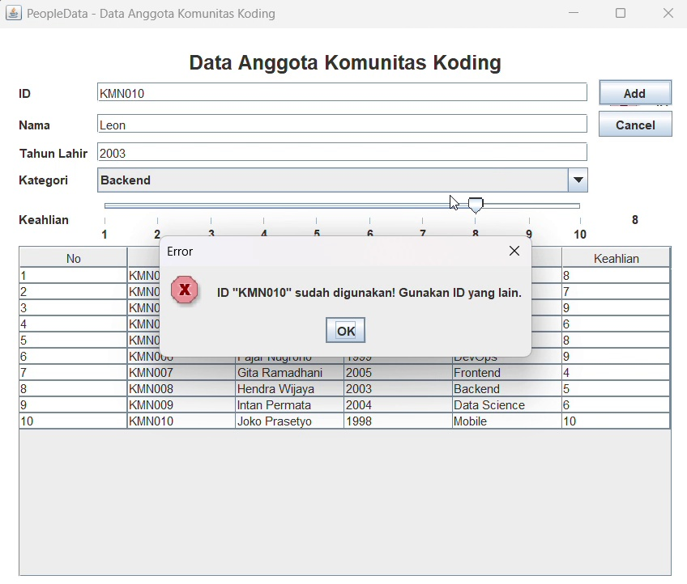
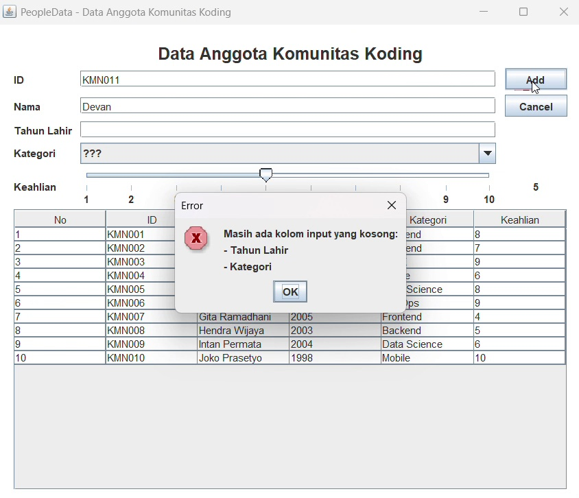
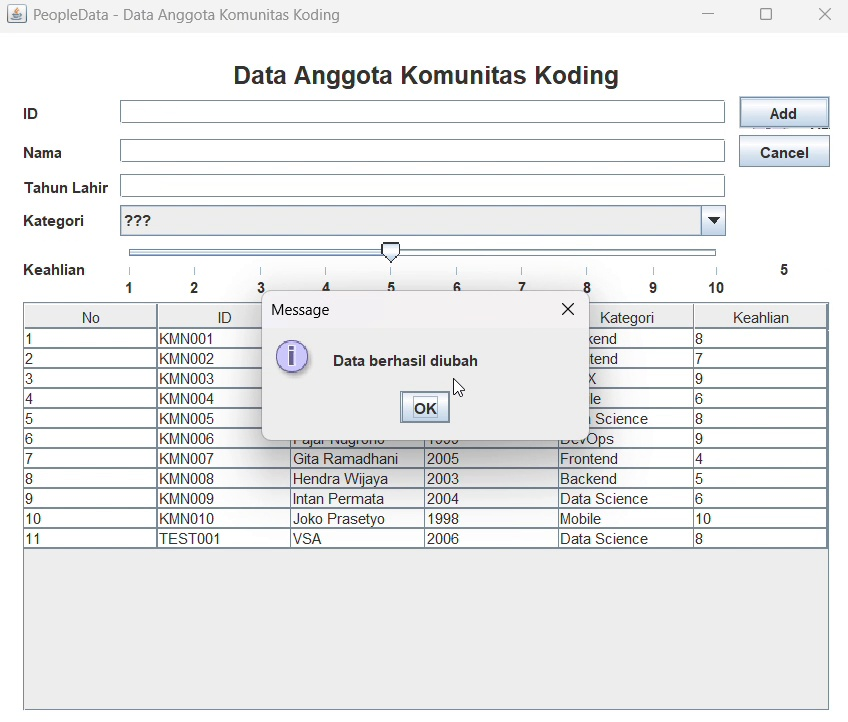
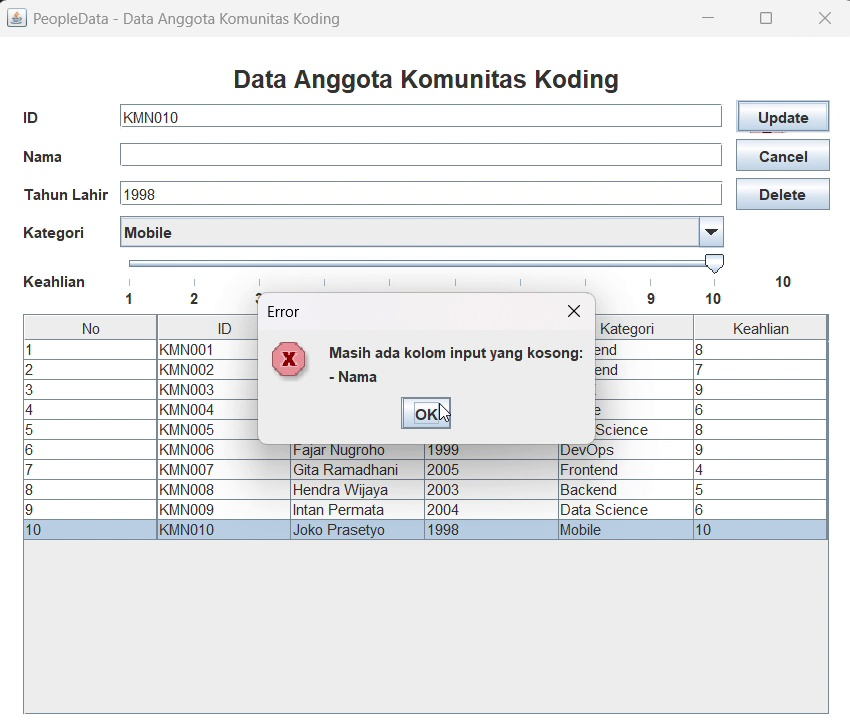
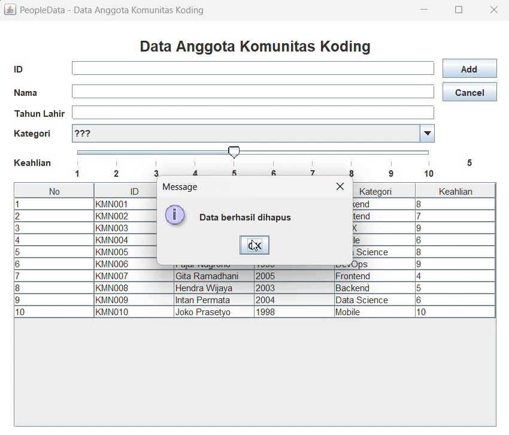
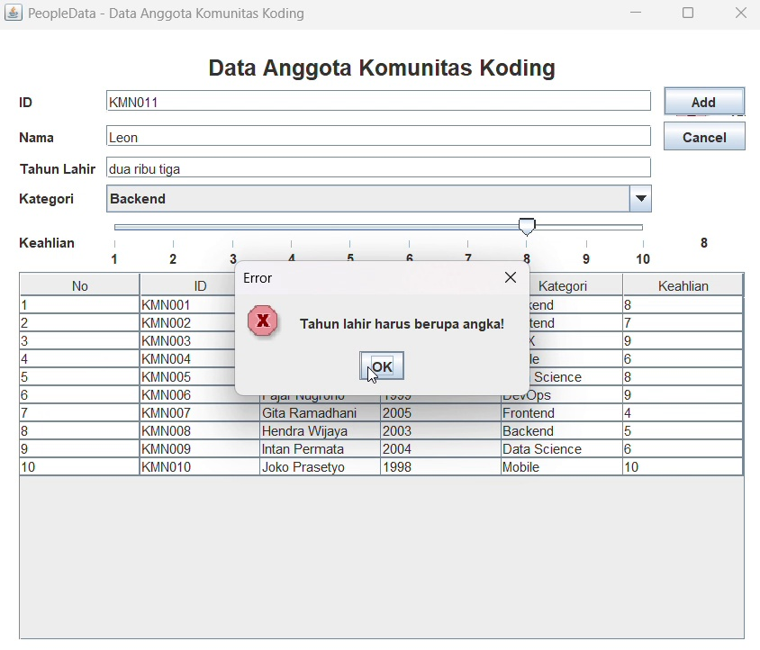
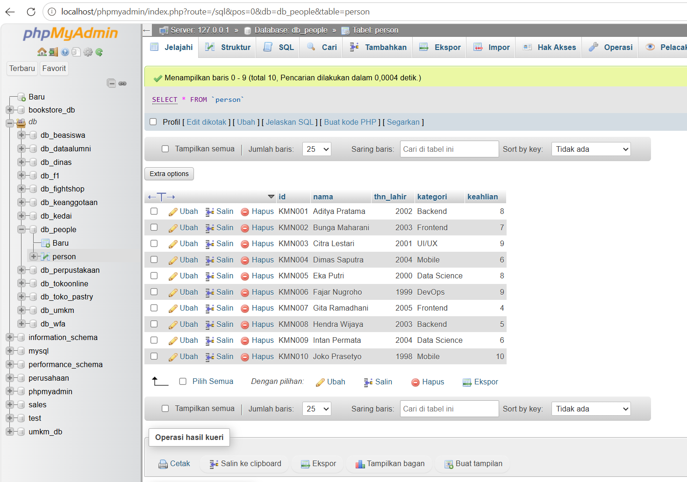

# TP5DPBO2526C1 — PeopleData

## Tugas Praktikum 5 DPBO: Java Swing GUI dan MySQL

**Nama:** Vanisha Septiani Auliaputri  
**NIM:** 2510735  
**Program Studi:** Ilmu Komputer C1, Universitas Pendidikan Indonesia

---

## Janji

Saya Vanisha Septiani Auliaputri dengan NIM 2510735 mengerjakan Tugas Praktikum 5 dalam mata kuliah Desain dan Pemrograman Berorientasi Objek untuk keberkahanNya maka saya tidak melakukan kecurangan seperti yang telah dispesifikasikan. Aamiin.
## Desain Program

**PeopleData** adalah aplikasi desktop untuk mengelola data anggota komunitas koding. Program dibuat menggunakan **Java Swing** untuk antarmuka dan **MySQL** sebagai tempat penyimpanan data. TP5 melanjutkan program TP4: data yang sebelumnya dikelola di dalam program sekarang dibaca dan diubah langsung melalui database dengan bantuan JDBC dan MySQL Connector/J.

Fitur utama aplikasi:

- **Create:** menambahkan data anggota melalui form dan menyimpannya ke database.
- **Read:** menampilkan isi tabel `person` pada `JTable`.
- **Update:** mengubah data anggota yang dipilih dari tabel.
- **Delete:** menghapus anggota setelah pengguna menyetujui dialog konfirmasi.
- **Validasi:** menolak input yang belum lengkap, tahun lahir yang tidak valid, dan ID yang sudah digunakan.

### Komponen antarmuka

| Komponen | Fungsi |
|---|---|
| `JTextField` ID | Mengisi ID unik anggota. |
| `JTextField` Nama | Mengisi nama anggota. |
| `JTextField` Tahun Lahir | Mengisi tahun lahir dalam bentuk angka. |
| `JComboBox` Kategori | Memilih kategori bidang, seperti Backend, Frontend, Mobile, Data Science, DevOps, atau UI/UX. Pilihan `???` berarti belum memilih kategori. |
| `JSlider` Keahlian | Memilih tingkat keahlian dari 1 sampai 10. |
| `JLabel` nilai keahlian | Menampilkan angka yang sedang dipilih pada slider. |
| `JTable` | Menampilkan data anggota yang berasal dari MySQL. |
| Tombol Add/Update | Menambahkan data saat belum ada baris terpilih, atau mengubah data saat sebuah baris dipilih. |
| Tombol Delete | Meminta konfirmasi sebelum menghapus data yang dipilih. |
| Tombol Cancel | Membersihkan isian form dan mengembalikan aplikasi ke mode Add. |

### Class pada program

#### 1. `Person.java`

Class `Person` merepresentasikan satu data anggota. Atributnya adalah `id`, `nama`, `tahunLahir`, `kategori`, dan `keahlian`. Class ini menyediakan constructor serta getter dan setter untuk mengakses atribut tersebut. Pada TP5, class ini tetap menjadi representasi data, sedangkan penyimpanan utama dilakukan di database, bukan di `ArrayList`.

#### 2. `PeopleMenu.java`

Class `PeopleMenu` merupakan jendela utama aplikasi dan mewarisi `JFrame`. Form dirancang pada `PeopleMenu.form` dengan Swing UI Designer, sedangkan event handler, validasi, dan proses CRUD ditulis pada `PeopleMenu.java`.

Method penting pada class ini:

- `main()` — membuat dan menampilkan jendela aplikasi; jika koneksi gagal, pesan error ditampilkan.
- `setTable()` — mengambil data dari database dan menyusunnya menjadi model untuk `JTable`.
- `insertData()` — memvalidasi form lalu menjalankan proses `INSERT`.
- `updateData()` — memvalidasi form lalu menjalankan proses `UPDATE` pada data yang dipilih.
- `deleteData()` — menjalankan proses `DELETE` setelah konfirmasi pengguna.
- `clearForm()` — membersihkan form dan mengembalikan tombol ke mode Add.
- `isInputValid()` dan `isIdUsed()` — memeriksa kelengkapan form, tahun lahir, dan ID duplikat.
- `showError()` dan `showDatabaseError()` — menampilkan pesan saat validasi atau operasi database gagal.

Ketika sebuah baris dipilih, nilai form diambil dari model tabel. Program juga menyimpan ID asli baris tersebut pada `selectedId`, sehingga Update dan Delete tetap merujuk ke data yang benar meskipun nilai ID pada form diubah.

#### 3. `Database.java`

Class `Database` menangani koneksi JDBC ke MySQL serta eksekusi query.

- `selectQuery(String sql)` — menjalankan query `SELECT` tanpa parameter.
- `selectQuery(String sql, Object... params)` — menjalankan `SELECT` dengan parameter menggunakan `PreparedStatement`.
- `insertUpdateDeleteQuery(String sql)` — menjalankan perintah `INSERT`, `UPDATE`, atau `DELETE` tanpa parameter.
- `insertUpdateDeleteQuery(String sql, Object... params)` — menjalankan perintah tulis dengan parameter dan mengembalikan jumlah baris yang terpengaruh.

Versi query berparameter digunakan untuk memasukkan nilai dari form secara terpisah dari teks SQL. Hal ini membantu menangani teks yang mengandung tanda petik dan mengurangi risiko SQL injection.

## Desain Database

Database yang digunakan bernama **`db_people`**, dengan satu tabel utama bernama **`person`**. Kolom `email` dari contoh SQL pada modul diganti menjadi `keahlian` agar sesuai dengan atribut tambahan di TP4.

| Kolom | Tipe data | Ketentuan dan penggunaan |
|---|---|---|
| `id` | `VARCHAR(255)` | Primary key, harus unik. |
| `nama` | `VARCHAR(255)` | Wajib diisi. |
| `thn_lahir` | `INT` | Wajib diisi dengan tahun yang valid. |
| `kategori` | `VARCHAR(255)` | Wajib diisi dengan kategori yang dipilih. |
| `keahlian` | `INT` | Nilai tingkat keahlian 1–10 dari slider. |

File struktur database dan data awal disediakan pada [`db_people.sql`](db_people.sql). File tersebut memasukkan 10 data awal dengan ID `KMN001` sampai `KMN010`.

> **Perhatian:** `db_people.sql` menjalankan `DROP TABLE IF EXISTS person`. Saat file ini diimpor ulang, tabel `person` akan dibuat ulang dan 10 data awal dimasukkan kembali. Ekspor atau backup data `person` terlebih dahulu bila ada perubahan yang ingin dipertahankan. Perintah ini tidak menghapus database lain di server MySQL.

## Alur Program

### 1. Membuka aplikasi dan menampilkan data

Aplikasi membuat objek `Database`, kemudian membaca data pada tabel `person` menggunakan `SELECT`. Hasil query ditampilkan di `JTable`. Jika koneksi tidak berhasil, aplikasi menampilkan dialog yang menjelaskan bahwa koneksi database gagal.

### 2. Menambahkan data — Create

Pengguna mengisi ID, Nama, Tahun Lahir, dan memilih Kategori, lalu menyesuaikan Keahlian dengan slider. Saat tombol **Add** ditekan, program memeriksa input dan memastikan ID belum digunakan. Jika semua valid, data dikirim melalui perintah `INSERT`, tabel dibaca ulang, dan form dikosongkan.

### 3. Membaca data — Read

Data dibaca dari database setiap kali tabel ditampilkan atau diperbarui. Saat baris dipilih, nilai-nilai pada baris tersebut dimasukkan kembali ke form. Tombol Add berubah menjadi Update dan tombol Delete ditampilkan.

### 4. Mengubah data — Update

Pengguna memilih baris, mengubah nilai pada form, lalu menekan **Update**. Validasi dijalankan kembali sebelum query `UPDATE`. Saat memeriksa duplikasi ID, ID asli milik baris yang sedang diubah dikecualikan agar pengguna tetap bisa menyimpan data tanpa dianggap memakai ID orang lain. Query menggunakan `selectedId` sebagai penunjuk data lama.

### 5. Menghapus data — Delete

Setelah pengguna memilih baris dan menekan **Delete**, aplikasi menampilkan dialog konfirmasi dengan pilihan **Ya** dan **Tidak**. Data hanya dihapus dari database jika pengguna memilih Ya. Jika Tidak dipilih, penghapusan dibatalkan.

### 6. Membersihkan form — Cancel

Tombol **Cancel** mengosongkan text field, mengembalikan ComboBox ke pilihan awal, mengatur slider kembali ke nilai 5, membersihkan pilihan tabel, dan mengembalikan tombol ke mode Add.

## Validasi dan Dialog Error

Validasi dilakukan sebelum data dikirim ke database. Jika ada kesalahan, operasi dihentikan dan dialog error ditampilkan.

| Kondisi | Respons aplikasi |
|---|---|
| ID, Nama, atau Tahun Lahir kosong | Menampilkan nama kolom yang belum diisi. |
| Kategori masih `???` | Meminta pengguna memilih kategori terlebih dahulu. |
| Tahun lahir berisi teks, misalnya `abcd` | Menampilkan pesan bahwa tahun lahir harus berupa angka. |
| Tahun lahir kurang dari 1900 atau melebihi tahun berjalan | Menampilkan rentang tahun yang diperbolehkan. |
| ID sudah dipakai anggota lain ketika Add atau Update | Menampilkan pesan ID sudah digunakan dan membatalkan operasi. |
| Koneksi database atau operasi SQL gagal | Menampilkan dialog kegagalan operasi/koneksi. |
| Pengguna menekan Delete | Meminta konfirmasi sebelum penghapusan. |

Slider Keahlian selalu mempunyai nilai 1–10 dan nilai awal 5, sehingga tidak menggunakan pemeriksaan input kosong seperti text field.

## Cara Menjalankan Program

### Persiapan MySQL

1. Buka XAMPP Control Panel dan jalankan **MySQL**.
2. Buka `http://localhost/phpmyadmin`.
3. Pilih menu **Import**, lalu pilih file `db_people.sql` pada repository.
4. Jalankan import dan pastikan database `db_people` memiliki tabel `person` berisi 10 data awal.

Ingat bahwa import ulang akan membuat ulang tabel `person`. Simpan backup bila ada data yang ingin dipertahankan.

### Persiapan MySQL Connector/J

1. Unduh MySQL Connector/J melalui [MySQL Community Downloads](https://dev.mysql.com/downloads/connector/j/).
2. Ekstrak file ZIP dan letakkan file `.jar` di folder `PeopleData/lib/`.
3. Di IntelliJ IDEA, buka **File → Project Structure → Modules → Dependencies**.
4. Klik **+ → JARs or Directories**, pilih file Connector/J, pastikan scope **Compile**, lalu klik **Apply** dan **OK**.

File `.jar` tidak disertakan pada repository ini; petunjuk penempatannya tersedia pada `PeopleData/lib/README.txt`.

### Menjalankan aplikasi

1. Buka repository project di IntelliJ IDEA.
2. Pastikan Project SDK menggunakan JDK yang tersedia dan Connector/J telah ditambahkan sebagai dependency pada modul yang benar.
3. Pastikan MySQL aktif dan database `db_people` sudah disiapkan.
4. Buka `PeopleData/PeopleMenu.java`, lalu jalankan method `main()` melalui ikon Run di samping deklarasi `main`.
5. Jendela PeopleData akan tampil dan membaca data dari MySQL jika konfigurasi berhasil.

Pengaturan koneksi default pada `Database.java` adalah `jdbc:mysql://localhost:3306/db_people`, dengan user `root` dan password kosong. Sesuaikan jika konfigurasi XAMPP di komputer berbeda.

## Dokumentasi Pengujian

Dokumentasi dipisahkan berdasarkan bagian agar setiap proses dapat diperiksa sendiri. Untuk video, klik thumbnail atau tautan **Buka video** di bawahnya. File berada pada folder `Dokumentasi/`.

### READ — Tampilan Awal

Tampilan awal memperlihatkan form kosong dan data anggota dari database.



### CREATE — Tambah Anggota

Video berikut menunjukkan proses mengisi form dan menambahkan anggota melalui tombol Add.

[](Dokumentasi/02-create.mp4)  
[**Buka video Create (MP4)**](Dokumentasi/02-create.mp4)

### CREATE — ID Sudah Digunakan

Jika ID telah terdaftar pada database, penambahan data ditolak dan aplikasi memberi tahu pengguna.

[](Dokumentasi/07-validasi-id-duplikat.mp4)  
[**Buka video validasi ID duplikat (MP4)**](Dokumentasi/07-validasi-id-duplikat.mp4)

### CREATE — Kolom Wajib Kosong

Video ini memperlihatkan respons aplikasi ketika tombol Add ditekan sementara ada input wajib yang belum terisi.

[](Dokumentasi/05-validasi-insert-kolom-kosong.mp4)  
[**Buka video validasi Create (MP4)**](Dokumentasi/05-validasi-insert-kolom-kosong.mp4)

### UPDATE — Ubah Anggota

Video ini menunjukkan pemilihan baris, pengubahan data pada form, dan penyimpanan dengan tombol Update.

[](Dokumentasi/03-update.mp4)  
[**Buka video Update (MP4)**](Dokumentasi/03-update.mp4)

### UPDATE — Kolom Wajib Kosong

Video ini memperlihatkan dialog validasi saat pengguna mencoba memperbarui data dengan kolom wajib yang masih kosong.

[](Dokumentasi/06-validasi-update-kolom-kosong.mp4)  
[**Buka video validasi Update (MP4)**](Dokumentasi/06-validasi-update-kolom-kosong.mp4)

### DELETE — Konfirmasi dan Hapus

Penghapusan memerlukan persetujuan pengguna. Video ini menunjukkan dialog konfirmasi dan proses setelah pilihan diberikan.

[](Dokumentasi/04-delete.mp4)  
[**Buka video Delete (MP4)**](Dokumentasi/04-delete.mp4)

### VALIDASI — Tahun Lahir Bukan Angka

Video ini memperlihatkan validasi ketika kolom Tahun Lahir diisi dengan teks, bukan angka.

[](Dokumentasi/08-validasi-tahun-bukan-angka.mp4)  
[**Buka video validasi tahun lahir (MP4)**](Dokumentasi/08-validasi-tahun-bukan-angka.mp4)

### BUKTI DATABASE — Tabel `person`

Gambar berikut memperlihatkan data anggota pada tabel `person` melalui phpMyAdmin.



## Struktur Repository

```text
TP5DPBO2526C1/
├── PeopleData/
│   ├── lib/
│   │   └── README.txt
│   ├── Database.java
│   ├── Person.java
│   ├── PeopleMenu.java
│   └── PeopleMenu.form
├── Dokumentasi/
│   ├── 01-read-tampilan-awal.png
│   ├── 02-create.mp4
│   ├── 03-update.mp4
│   ├── 04-delete.mp4
│   ├── 05-validasi-insert-kolom-kosong.mp4
│   ├── 06-validasi-update-kolom-kosong.mp4
│   ├── 07-validasi-id-duplikat.mp4
│   ├── 08-validasi-tahun-bukan-angka.mp4
│   ├── 09-bukti-tabel-database.png
│   └── preview/ (thumbnail yang dipakai README)
├── db_people.sql
└── README.md
```

---

**TP5 ini melanjutkan PeopleData dari TP4 dengan memindahkan penyimpanan data ke MySQL.** Antarmuka Swing tetap dipakai, sedangkan proses CRUD dan validasi dijalankan melalui `PeopleMenu.java` dan `Database.java`.
